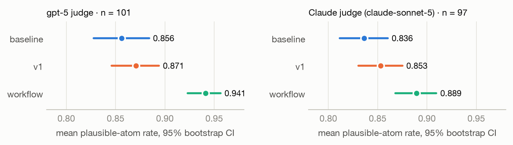
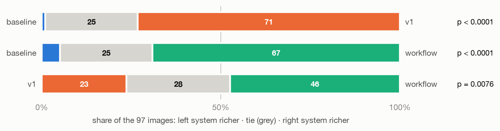

# VibeAI

Can an AI describe the *vibe* of a photo (its mood, atmosphere and aesthetic feeling) in a way that is both true and complete? VibeAI measures this with a decompose-then-verify pipeline: write a vibe representation, split it into atomic vibe claims, and have LLM judges check those claims.

## Results

Three methods were compared, all generated by gpt-5: a one-line **baseline** prompt, the guided **v1** prompt, and the **workflow**, which starts from v1 and revises it with judge feedback.





- **The workflow makes representations more plausible.** It beats both baseline and v1 under the gpt-5 judge (+0.085 / +0.070, p < 0.0001) and under an independent Claude judge (+0.053 / +0.036, p ≤ 0.0064), mostly by fixing evidence-backed claims.
- **v1 is no more plausible than baseline overall**, though it is as good or better within each claim type: it writes far more evidence-backed claims (63% of atoms vs 42%), the harder kind, and the mix shift cancels the gain.
- **v1 and the workflow are far richer than baseline.** Judged head to head by Claude on 97 images, v1 wins 71–1 and the workflow 67–5 (25 ties each, p < 0.0001), and both gaps survive controlling for how many vibes each set lists.
- **The workflow's richness edge over v1 is not distinguishable from length.** It wins 46–23 (28 ties, p = 0.0076), but it also lists about one more vibe per image; at equal set size the two are level (p = 0.60).
- **The judges agree with a human annotator** on plausibility (Cohen's κ = 0.82) and decomposition quality (0.64–0.70). The richness judge has not been human-validated yet.

Full write-up, with method details and limitations: [`vibeai_report.pdf`](vibeai_report.pdf).

## How it works

```
image → generate representation → decompose into atoms → LLM judges
             ↑                                          │
             └──── refine with feedback (workflow) ─────┘
```

| metric | question | reference |
| --- | --- | --- |
| plausibility | is each atom true of the image? | the image |
| richness | of two methods' vibe sets, which captures more of the image's vibe? | the image + the other method's vibes (pairwise, both A/B orders, Claude judge) |
| decomposition quality | do the atoms faithfully and completely decompose the representation? | the representation |
| breadth | of the vibe aspects this image supports, how many did it touch at all? | the image |

Breadth is the workflow's stand-in for richness: richness needs a second method to compare against and is the benchmark the workflow is scored on, so the loop gates on breadth instead.

Significance: plausibility uses a paired sign-flip permutation test (`vibeai/eval/significance.py`); richness uses an exact sign test over decisive comparisons, plus a Bradley–Terry fit with set size as a covariate (`vibeai/eval/richness_control.py`).

An earlier richness metric scored coverage of a "vibe pool" built from four independent representations of 10 holdout images. It was retired: the pool rested on unverifiable construction prompts and an LLM synonym merge, and its cost kept it to 10 images. Its data and the report that used it are archived locally under `deprecated/` (not tracked).

## Setup

```bash
uv sync
```

Requires `OPENAI_API_KEY` in `.env`, plus `ANTHROPIC_API_KEY` for any `claude-*` model. Images live under `data/`, which is not tracked.

## Commands

```bash
# run all tests
uv run pytest tests/ -v -s

# batch eval on a sample / all images (--n-images defaults to 5)
uv run pytest tests/test_decomposition_quality.py --n-images=20 -s
uv run pytest tests/test_plausibility.py --n-images=all -s

# score the workflow's output with the same judges/models as the prompt runs:
# --representation-prompt-version=workflow reuses results/workflow/*.representations.json,
# and runs the workflow for any image that doesn't have one yet.
uv run pytest tests/test_plausibility.py --representation-prompt-version=workflow --n-images=all -s

# richness: pairwise, per image, which method's vibe set is richer (Claude judge by default).
# Reads the bare vibes out of existing v2-decomposed runs - nothing is regenerated.
# Every comparison is judged in both A/B orders; a position-driven conflict counts as a tie.
uv run -m vibeai.eval.richness_comparison plausibility \
    baseline__v2_1790134860 v1__v2_1790132953 workflow__v2_1790134094
uv run -m vibeai.eval.richness_comparison plausibility <run> <run> --labels v1 workflow --n-images 10

# is a richness win more than "its sets are longer"? Bradley-Terry with set size as a covariate
uv run -m vibeai.eval.richness_control <richness run>

# other batch eval options (defaults shown)
uv run pytest tests/test_decomposition_quality.py --image-dir=data/main_processed -s
uv run pytest tests/test_decomposition_quality.py --representation-prompt-version=v1 -s
uv run pytest tests/test_decomposition_quality.py --decomposition-prompt-version=v2 -s
uv run pytest tests/test_decomposition_quality.py --concurrency=30 -s

# models: the two pipeline calls and the judge are set independently
# (DEFAULT_MODEL / DEFAULT_DECOMPOSITION_MODEL / DEFAULT_EVAL_MODEL, all gpt-5)
uv run pytest tests/test_decomposition_quality.py --representation-model=gpt-5 -s
uv run pytest tests/test_decomposition_quality.py --decomposition-model=gpt-5 -s
uv run pytest tests/test_decomposition_quality.py --eval-model=gpt-5 -s

# generator-evaluator workflow: loop one image until both judges accept it.
# Every call in the loop uses DEFAULT_MODEL.
uv run -m vibeai.pipeline.workflow data/richness_holdout/2025.jpg
uv run -m vibeai.pipeline.workflow <image> --max-rounds 5 --plausible-rate 0.9 --out trace.json

# ...and over an image set.
uv run -m vibeai.pipeline.workflow_batch --image-dir data/main_processed --n-images 20 --concurrency 10
# writes results/workflow/<run>.json (summary), .per_image.jsonl (full traces) and
# .representations.json (image -> final representation, the input to a scoring pass)

# human annotation webapps + read-only results viewers
# (decomposition quality, plausibility, pairwise richness — cross-linked from every start screen)
uv run uvicorn vibeai.webapp.server:app --reload   # then open http://localhost:8000

# LLM/human agreement (Cohen's kappa)
uv run -m vibeai.eval.human_alignment <run> --metric <metric> --annotator <name>

# is the gap between two runs real? paired permutation test over the images
# they share, pairwise across however many runs are given; also saved to
# results/significance/<metric>__<run>+<run>....json
uv run -m vibeai.eval.significance plausibility <run_a> <run_b> [<run_c> ...]

# report figures (docs/figures/) and the PDF report, from saved results only
uv run --with matplotlib python docs/make_figures.py
"/Applications/Google Chrome.app/Contents/MacOS/Google Chrome" --headless --no-pdf-header-footer \
    --print-to-pdf=vibeai_report.pdf docs/report.html
```

Models are routed by id: ids starting with `claude-` go to the Anthropic Messages API, everything else to the OpenAI Responses API. The daily token budget and per-call usage log track the OpenAI account's TPD limit only, so Anthropic calls are cached and retried but not metered.

LLM calls are cached under `.cache/llm/`, keyed by `(model, prompt, image)`. Batch results are written under `results/<metric_name>/<run_name>.json` (summary) and `.per_image.jsonl` (per-image detail).

## Extending

- **Prompt version**: add an entry to the relevant dict in `vibeai/prompts/` (e.g. `representation.py`), then pass `prompt_version="your_version"`.
- **Metric**: subclass `vibeai.metrics.base.Metric`, implement `measure(test_case) -> MetricResult`; see `metrics/decomposition_quality.py` or `metrics/plausibility.py` for examples. Pairwise metrics such as `metrics/richness.py` don't fit that interface and run through their own runner.

See `vibeai/` module docstrings and `tests/` for further detail on project layout.
