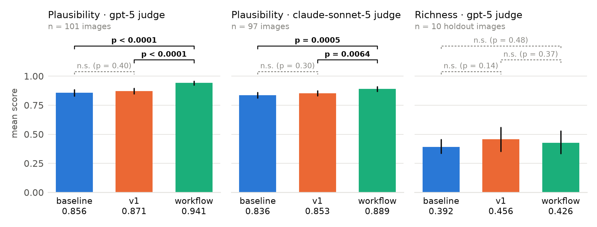

# VibeAI

Can an AI describe the *vibe* of a photo (its mood, atmosphere and aesthetic feeling) in a way that is both true and complete? VibeAI measures this with a decompose-then-verify pipeline: write a vibe representation, split it into atomic vibe claims, and have LLM judges check those claims.

## Results



Three methods were compared, all generated by gpt-5: a one-line **baseline** prompt, the guided **v1** prompt, and the **workflow**, which starts from v1 and revises it with judge feedback.

- **The workflow makes representations more plausible.** It beats both baseline and v1 under the gpt-5 judge (+0.085 / +0.070, p < 0.0001) and under an independent Claude judge (+0.053 / +0.036, p ≤ 0.0064).
- **Richness does not separate the methods.** No difference is significant on the 10 holdout images.
- **The judges agree with a human annotator**: Cohen's κ = 0.82 for plausibility and 0.64–0.70 for decomposition quality.

Full write-up, with method details and limitations: [`vibeai_report.pdf`](vibeai_report.pdf).

## How it works

```
image → generate representation → decompose into atoms → LLM judges
             ↑                                          │
             └──── refine with feedback (workflow) ─────┘
```

| metric | question | reference |
| --- | --- | --- |
| plausibility | is each atom true of the image? | the image |
| richness | how much of what is really there did the representation say? | a vibe pool built from four independent branches |
| decomposition quality | do the atoms faithfully and completely decompose the representation? | the representation |
| breadth | of the vibe aspects this image supports, how many did it touch at all? | the image |

Breadth is the workflow's pool-free stand-in for richness. The pool is the answer key richness is scored against, so the loop must not see it.

Significance is a paired sign-flip permutation test (`vibeai/eval/significance.py`).

## Setup

```bash
uv sync
```

Requires `OPENAI_API_KEY` in `.env`, plus `ANTHROPIC_API_KEY` for any `claude-*` model. Images live under `data/`, which is not tracked.

## Commands

```bash
# run all tests
uv run pytest tests/ -v -s

# batch eval on a sample / all images (--n-images defaults to 5)
uv run pytest tests/test_decomposition_quality.py --n-images=20 -s
uv run pytest tests/test_plausibility.py --n-images=all -s

# score the workflow's output with the same judges/models as the prompt runs:
# --representation-prompt-version=workflow reuses results/workflow/*.representations.json,
# and runs the workflow for any image that doesn't have one yet.
uv run pytest tests/test_plausibility.py --representation-prompt-version=workflow --n-images=all -s
uv run pytest tests/test_richness.py --representation-prompt-version=workflow --n-images=all -s

# richness: how much of each holdout image's vibe pool a representation covered.
# The image set comes from the pool file, not --image-dir; the pool used is recorded in the run summary.
uv run pytest tests/test_richness.py --n-images=all -s
uv run pytest tests/test_richness.py --n-images=all --pool=annotations/richness_holdout.claude.vibes.json -s

# other batch eval options (defaults shown)
uv run pytest tests/test_decomposition_quality.py --image-dir=data/main_processed -s
uv run pytest tests/test_decomposition_quality.py --representation-prompt-version=v1 -s
uv run pytest tests/test_decomposition_quality.py --decomposition-prompt-version=v2 -s
uv run pytest tests/test_decomposition_quality.py --concurrency=30 -s

# models: the two pipeline calls and the judge are set independently
# (DEFAULT_MODEL / DEFAULT_DECOMPOSITION_MODEL / DEFAULT_EVAL_MODEL, all gpt-5)
uv run pytest tests/test_decomposition_quality.py --representation-model=gpt-5 -s
uv run pytest tests/test_decomposition_quality.py --decomposition-model=gpt-5 -s
uv run pytest tests/test_decomposition_quality.py --eval-model=gpt-5 -s

# build the vibe pool for a holdout set (default: gpt-5.6-luna and claude-sonnet-5 x baseline and v1,
# kept independent of the gpt-5 systems under test)
uv run -m vibeai.pipeline.pool_construction --image-dir data/richness_holdout
uv run -m vibeai.pipeline.pool_construction --models claude-sonnet-5 --out annotations/richness_holdout.claude.vibes.json

# generator-evaluator workflow: loop one image until both judges accept it.
# Every call in the loop uses DEFAULT_MODEL.
uv run -m vibeai.pipeline.workflow data/richness_holdout/2025.jpg
uv run -m vibeai.pipeline.workflow <image> --max-rounds 5 --plausible-rate 0.9 --out trace.json

# ...and over an image set. --pool takes the image set from a vibe pool file, so the run
# covers exactly the images richness can then be scored on.
uv run -m vibeai.pipeline.workflow_batch --pool
uv run -m vibeai.pipeline.workflow_batch --image-dir data/main_processed --n-images 20 --concurrency 10
# writes results/workflow/<run>.json (summary), .per_image.jsonl (full traces) and
# .representations.json (image -> final representation, the input to a scoring pass)

# human annotation webapps + read-only results viewers
# (decomposition quality, plausibility, richness — cross-linked from every start screen)
uv run uvicorn vibeai.webapp.server:app --reload   # then open http://localhost:8000

# LLM/human agreement (Cohen's kappa)
uv run -m vibeai.eval.human_alignment <run> --metric <metric> --annotator <name>

# is the gap between two runs real? paired permutation test over the images
# they share, pairwise across however many runs are given; also saved to
# results/significance/<metric>__<run>+<run>....json
uv run -m vibeai.eval.significance plausibility <run_a> <run_b> [<run_c> ...]
```

Models are routed by id: ids starting with `claude-` go to the Anthropic Messages API, everything else to the OpenAI Responses API. The daily token budget and per-call usage log track the OpenAI account's TPD limit only, so Anthropic calls are cached and retried but not metered.

LLM calls are cached under `.cache/llm/`, keyed by `(model, prompt, image)`. Batch results are written under `results/<metric_name>/<run_name>.json` (summary) and `.per_image.jsonl` (per-image detail).

## Extending

- **Prompt version**: add an entry to the relevant dict in `vibeai/prompts/` (e.g. `representation.py`), then pass `prompt_version="your_version"`.
- **Metric**: subclass `vibeai.metrics.base.Metric`, implement `measure(test_case) -> MetricResult`; see `metrics/decomposition_quality.py` or `metrics/plausibility.py` for examples.

See `vibeai/` module docstrings and `tests/` for further detail on project layout.
